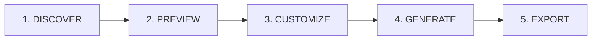

# StyPro — From Style to Prompt to Code

> **Discover professional UI design styles, customize visual tokens with live feedback, generate implementation-ready AI prompts, and export clean production code.**

[](https://nextjs.org/)
[](https://react.dev/)
[](https://tailwindcss.com/)
[](https://www.typescriptlang.org/)
[](https://nodejs.org/)

---

## The Problem StyPro Solves

Developers, indie hackers, and founders often know what visual direction they want for their application, but struggle to:
1. Translate visual inspiration into strict, cohesive design system rules.
2. Communicate nuanced design constraints to AI coding assistants (e.g. Antigravity, Cursor, Claude Code).
3. Export valid, production-ready tokens for CSS and Tailwind setups without manual re-keying.

**StyPro solves this with a structured 5-step workflow:**



1. **Discover:** Browse 12 curated, distinct design languages with category filters and search.
2. **Preview:** Inspect realistic simulated components (navigation, hero, cards, forms, metrics, buttons).
3. **Customize:** Tweak colors, typography, spacing, border radii, and drop shadows in real time.
4. **Generate:** Produce deterministic, 14-section design-system prompts optimized for AI coding agents.
5. **Export:** Download or copy implementation-ready CSS Custom Properties, Tailwind v4/v3 configs, DTCG standard JSON tokens, or Markdown specs.

---

## Curated Design Style Library

StyPro ships with **12 complete, production-grade design systems**:

| Slug | Style Name | Category | Dominant Aesthetic Signature |
|---|---|---|---|
| `modern-dark` | **Modern Dark** | Developer Tool | Linear-grade obsidian `#050506` canvas, electric indigo `#5E6AD2` |
| `swiss-minimalist` | **Swiss Minimalist** | Minimalist | International Typographic style, pure `#FFFFFF`, International Orange `#FF3B00` |
| `neo-brutalist` | **Neo-Brutalist Pop** | Neo-Brutalist | Stark 2.5px black borders, zero-blur hard offset shadows, electric canary `#FFE600` |
| `cyber-deck` | **Cyberpunk Terminal Deck** | Cyberpunk | Deep void `#05080F`, phosphor mint `#00FF9D`, terminal CRT scanlines |
| `glass-aurora` | **Spatial Glass Aurora** | Spatial Glass | Frosted midnight `#070913`, 24px multi-layer glass blur, ethereal lilac `#8B5CF6` |
| `corporate-clean` | **Corporate Clean SaaS** | Enterprise | High-trust enterprise `#F8FAFC`, sovereign blue `#2563EB`, slate tables |
| `nordic-frost` | **Nordic Frost** | Minimalist | Scandinavian hygge, arctic snow `#F5F6F8`, charcoal `#24272A`, terracotta `#C86D51` |
| `midnight-bloom` | **Midnight Bloom** | Enterprise | Institutional wealth fintech `#030712`, radiant emerald `#10B981`, gold `#F59E0B` |
| `paper-ink` | **Paper & Ink** | Editorial | Tactile parchment `#F7F4EE`, sumi ink `#1B1714`, book arts serif hierarchy |
| `sunset-synth` | **Sunset Synthwave** | Cyberpunk | 1980s outrun twilight `#0D0221`, blazing fuchsia `#FF007F`, laser cyan `#00F0FF` |
| `claymorphic-soft` | **Claymorphic Soft** | Playful | Inflated 3D clay, warm porcelain `#F8F7F2`, gentle lavender `#7C3AED`, 20px squircles |
| `monochrome-wireframe` | **Monochrome Blueprint**| Developer Tool | CAD drafting navy `#090D16`, razor-thin technical lines, blueprint cyan `#38BDF8` |

---

## Core Capabilities

### 1. Interactive Visual Customizer (`/customize/[slug]`)
- **3-Pane Workspace:** Controls panel, live interactive preview viewport, and token/diff/prompt inspector.
- **Granular Category Resets:** Reset colors, typography, spacing, or geometry independently.
- **Diff Tracking:** Live indicator counting active token modifications against the canonical style baseline.
- **Local Persistence:** Changes automatically save to browser `localStorage`.

### 2. Deterministic AI Prompt Generation
- **Multi-Agent Formats:** Formatted specifically for **Antigravity**, **Cursor**, and **Claude Code**.
- **14 Structured Sections:** Role definition, visual philosophy, strict negative constraints, semantic color mapping, typography ladder, geometry rules, component anatomy, and implementation checklist.

### 3. Multi-Format Export Engine (`/export/[slug]`)
- **CSS Custom Properties (`.css`):** Scoped under `:root` with `--sty-*` prefix.
- **Tailwind CSS (`.css` / `.ts`):** Modern Tailwind v4 `@theme` block or classic Tailwind v3 `tailwind.config.ts`.
- **DTCG Standard JSON (`.json`):** W3C Design Tokens Community Group specification with `$value` and `$type`.
- **Markdown Specification (`.md`):** Comprehensive design handoff documentation.
- **Client-Side Execution:** 100% in-browser generation with instant file downloads and clipboard copying.

---

## Technology Stack

- **Framework:** Next.js 16.4.5 (Turbopack, App Router, Static Prerendering)
- **UI Library:** React 19.3.0
- **Styling:** Tailwind CSS v4
- **Icons:** Lucide React
- **Language:** TypeScript 5.x (Strict mode)
- **Testing:** Node.js 24 native test runner (`node:test`) + `tsx`

---

## Quickstart & Local Setup

### Prerequisites
- Node.js 20.x or Node.js 24.x
- npm 10.x or higher

### Installation
```bash
# Clone repository
git clone https://github.com/Abdulfatai2000/StyPro.git
cd StyPro

# Install dependencies
npm install

# Start development server
npm run dev
```

Visit [http://localhost:3000](http://localhost:3000) to view StyPro.

---

## Testing & Quality Assurance

StyPro includes a comprehensive unit test suite, TypeScript type checking, and ESLint coverage:

```bash
# Run unit tests (23 tests across 6 suites in ~1.2s)
npm test

# Run TypeScript type check
npx tsc --noEmit

# Run ESLint
npm run lint

# Run production build (compiles and prerenders all 44 routes)
npm run build
```

---

## Comprehensive Documentation

For deep technical specifications, consult the `docs/` directory:
- [Design Token Schema](file:///c:/Users/USER/Documents/COLDWANDE.DEV/StyPro/docs/DESIGN-TOKEN-SCHEMA.md)
- [Export Formats Specification](file:///c:/Users/USER/Documents/COLDWANDE.DEV/StyPro/docs/EXPORT-FORMATS.md)
- [Style Library Catalogue](file:///c:/Users/USER/Documents/COLDWANDE.DEV/StyPro/docs/STYLE-LIBRARY.md)
- [Technical Architecture Guide](file:///c:/Users/USER/Documents/COLDWANDE.DEV/StyPro/docs/PROJECT-ARCHITECTURE.md)
- [Testing & Verification Guide](file:///c:/Users/USER/Documents/COLDWANDE.DEV/StyPro/docs/TESTING.md)
- [Phase 3 Execution Log](file:///c:/Users/USER/Documents/COLDWANDE.DEV/StyPro/docs/PHASE-3-EXECUTION-LOG.md)

---

## License

MIT © 2026 StyPro Team.
