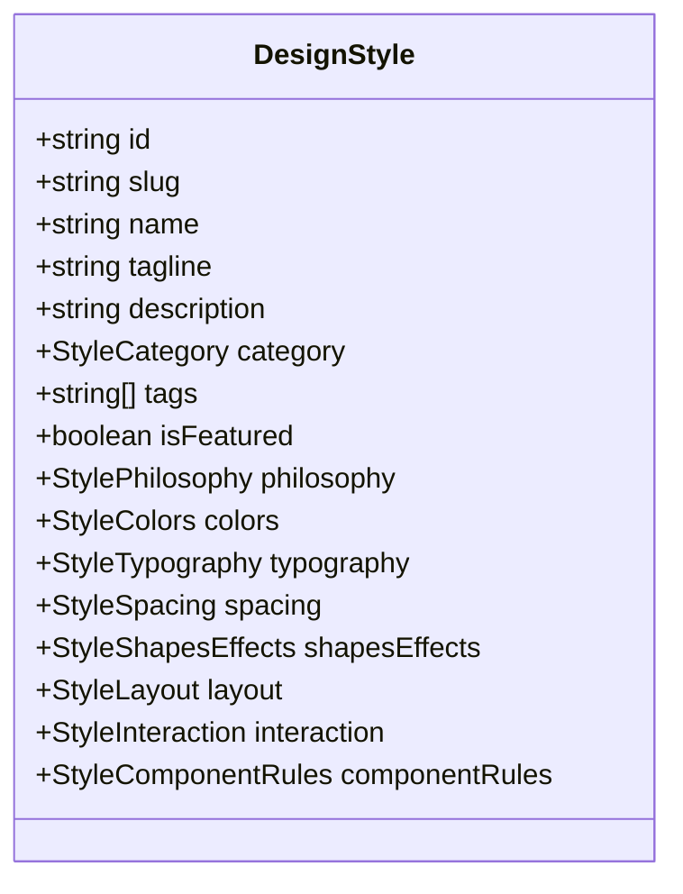

# StyPro — Design Token Schema Specification

## Architecture Overview

StyPro uses a centralized, strictly typed token schema (`DesignStyle`) as the single source of truth for:
1. Discovery presentations (`/explore`, `/styles/[slug]`)
2. Live interactive previews (`<StylePreview />`)
3. Interactive visual customization (`/customize/[slug]`)
4. Deterministic prompt generation (`generateSystemPrompt`)
5. Multi-format export engine (`/export/[slug]`)



---

## 1. Style Category Taxonomy

```typescript
export type StyleCategory =
  | 'developer-tool'  // High-density, developer-focused, dark canvas
  | 'minimalist'      // Swiss International, Bauhaus, monochrome, high contrast
  | 'editorial'       // Parchment, serif, literary, publication layout
  | 'neo-brutalist'   // Stark black borders, zero-blur hard shadows, saturated pops
  | 'enterprise'      // High trust, corporate precision, accessible slate & blue
  | 'cyberpunk'       // Terminal phosphor, neon CRT glow, scanlines
  | 'spatial-glass'   // Multi-layer frosted glass, iridescent aura, blurred backdrops
  | 'playful';        // Inflated 3D clay, pastels, bouncy squircle geometry
```

---

## 2. Color System (`StyleColors`)

StyPro defines 18 required semantic color roles:

```typescript
export interface StyleColors {
  // Canvas & Surfaces
  background: string;         // Root viewport canvas background
  foreground: string;         // Primary readable body text
  surface: string;            // Standard container/card background
  surfaceElevated: string;    // Dropdowns, modals, elevated panels

  // Brand Actions
  primary: string;            // Key interactive action / CTA background
  primaryHover: string;       // Primary CTA hover state
  primaryForeground: string;  // Text/icon color inside primary CTA
  secondary: string;          // Secondary action or pill background
  secondaryForeground: string;// Text color inside secondary action
  accent: string;             // Focal highlights, badge accents, links
  accentForeground: string;   // Text color inside accent elements

  // Tonal & Muted
  muted: string;              // Low-emphasis chip / toggle backgrounds
  mutedForeground: string;    // Secondary helper labels and captions

  // Borders & Rings
  border: string;             // Standard hairline container perimeter
  borderSubtle: string;       // Low-contrast internal table / list divider
  borderStrong: string;       // High-contrast focused boundary
  ring: string;               // Focus accessibility ring outline

  // Semantic Feedback States
  success: string;            // Positive delta, verified status, yield
  warning: string;            // Warning telemetry, alert threshold
  destructive: string;        // Destructive delete actions, errors
}
```

---

## 3. Typography System (`StyleTypography`)

```typescript
export interface StyleTypography {
  headingFont: string;       // CSS font-family stack for display & h1-h4
  bodyFont: string;          // CSS font-family stack for readable body copy
  monospaceFont: string;     // CSS font-family stack for code & numeric telemetry

  fontWeights: {
    regular: number;         // e.g. 400
    medium: number;          // e.g. 500
    semibold: number;        // e.g. 600
    bold: number;            // e.g. 700 or 900
  };

  fontSizes: {
    xs: string;              // e.g. '0.75rem' (12px)
    sm: string;              // e.g. '0.875rem' (14px)
    base: string;            // e.g. '1rem' (16px)
    lg: string;              // e.g. '1.125rem' (18px)
    xl: string;              // e.g. '1.25rem' (20px)
    '2xl': string;           // e.g. '1.5rem' (24px)
    '3xl': string;           // e.g. '1.875rem' (30px)
    '4xl': string;           // e.g. '2.25rem' (36px)
  };

  lineHeights: {
    tight: string;           // e.g. '1.2'
    normal: string;          // e.g. '1.5'
    relaxed: string;         // e.g. '1.75'
  };

  letterSpacing: {
    tight: string;           // e.g. '-0.02em'
    normal: string;          // e.g. '0em'
    wide: string;            // e.g. '0.04em'
  };
}
```

---

## 4. Spacing System (`StyleSpacing`)

```typescript
export interface StyleSpacing {
  scale: {
    '2xs': string;           // 0.25rem (4px)
    xs: string;              // 0.5rem (8px)
    sm: string;              // 0.75rem (12px)
    md: string;              // 1rem (16px)
    lg: string;              // 1.5rem (24px)
    xl: string;              // 2rem (32px)
    '2xl': string;           // 3rem (48px)
    '3xl': string;           // 4rem (64px)
  };
  sectionSpacing: string;    // Major page section vertical separation
  contentPadding: string;    // Page and container gutter padding
  componentGaps: string;     // Standard flex/grid intra-component gap
}
```

---

## 5. Shapes & Effects (`StyleShapesEffects`)

```typescript
export interface StyleShapesEffects {
  borderRadius: {
    none: string;            // '0px'
    sm: string;              // '2px' - '4px'
    md: string;              // '4px' - '8px'
    lg: string;              // '8px' - '16px'
    full: string;            // '9999px'
  };

  borderThickness: {
    thin: string;            // '1px'
    medium: string;          // '1.5px' - '2px'
    thick: string;           // '2.5px' - '3.5px'
  };

  borderStyle: 'solid' | 'dashed' | 'dotted';

  shadows: {
    none: string;            // 'none'
    sm: string;              // Subtle card rest shadow
    md: string;              // Hover / floating elevation
    lg: string;              // Modal / popover elevation
    colored?: string;        // Primary accent glow
  };

  elevation: string;         // Base elevation level ('0' - '4')
  backdropBlur: string;      // Frosted backdrop blur ('0px' - '24px')

  gradients?: {
    surface?: string;        // Surface sheen gradient
    glow?: string;           // Ambient atmospheric glow
  };
}
```

---

## 6. Customization Overrides Schema

When a user modifies a style in `/customize/[slug]`, the diff is stored as a `CustomizationOverrides` object:

```typescript
export interface CustomizationOverrides {
  colors?: Partial<StyleColors>;
  typography?: {
    headingFont?: string;
    bodyFont?: string;
    monospaceFont?: string;
    fontScaleModifier?: number;
  };
  spacing?: {
    scaleMultiplier?: number;
  };
  geometry?: {
    buttonRadius?: string;
    cardRadius?: string;
    borderThickness?: string;
  };
  effects?: {
    shadowIntensity?: 'subtle' | 'moderate' | 'dramatic' | 'none';
    glowEnabled?: boolean;
    backdropBlur?: string;
  };
  motion?: {
    reducedMotion?: boolean;
    speedMultiplier?: number;
  };
}
```

### Resolution Pipeline
```typescript
const resolvedStyle = resolveCustomizedStyle(canonicalStyle, overrides);
```
The resolver applies overrides non-destructively:
1. Replaces modified color tokens with valid hex codes.
2. Scales spacing scale increments when `scaleMultiplier` is altered.
3. Maps button and card border radii to individual component rules.
4. Updates CSS variable injectors dynamically without triggering page reloads.
