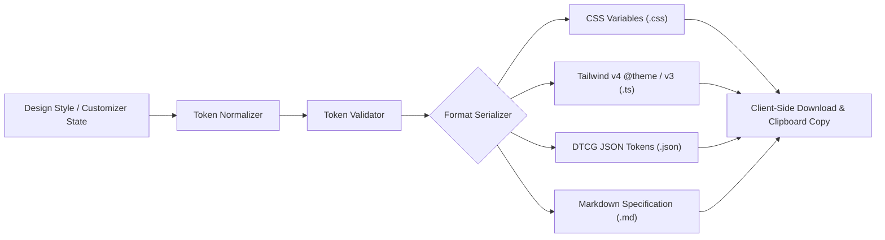

# StyPro — Export Engine & Format Specifications

## Overview

The StyPro Export Engine transforms canonical design systems and user customizations into implementation-ready artifacts for frontend developers, design engineers, and AI coding assistants.

Every export is generated deterministically directly in the browser—requiring zero external API calls, credentials, or backend processing.



---

## 1. CSS Custom Properties (`.css`)

### Target
Standard W3C CSS Custom Properties for vanilla CSS, CSS Modules, Sass/SCSS, and CSS-in-JS libraries.

### File Structure & Conventions
All tokens are declared within the `:root` pseudo-class and namespaced under the `--sty-` prefix to eliminate collisions with third-party CSS libraries:

| Token Category | CSS Variable Pattern | Example |
|---|---|---|
| Background & Canvas | `--sty-color-background`, `--sty-color-foreground` | `#050506`, `#F4F5F8` |
| Surfaces | `--sty-color-surface`, `--sty-color-surface-elevated` | `#090A0F`, `#11131A` |
| Primary Actions | `--sty-color-primary`, `--sty-color-primary-hover` | `#5E6AD2`, `#6E79D8` |
| Typography | `--sty-font-heading`, `--sty-font-body`, `--sty-font-mono` | `Inter, sans-serif` |
| Spacing Scale | `--sty-space-2xs` to `--sty-space-3xl` | `0.25rem` to `4rem` |
| Geometry & Radius | `--sty-radius-sm`, `--sty-radius-md`, `--sty-radius-full` | `4px`, `6px`, `9999px` |
| Shadows & Elevation | `--sty-shadow-sm`, `--sty-shadow-md`, `--sty-shadow-lg` | `0 4px 12px rgba(0,0,0,0.7)` |

### Integration Example
```html
<link rel="stylesheet" href="./modern-dark-tokens.css" />

<style>
  .card {
    background-color: var(--sty-color-surface);
    color: var(--sty-color-foreground);
    border: var(--sty-border-width-thin) solid var(--sty-color-border);
    border-radius: var(--sty-radius-md);
    padding: var(--sty-padding-content);
    box-shadow: var(--sty-shadow-md);
  }
</style>
```

---

## 2. Tailwind CSS Configuration (`.css` / `.ts`)

StyPro supports both the modern **Tailwind CSS v4** engine and legacy **Tailwind CSS v3** setups.

### A. Tailwind CSS v4 (`@theme` block)
Tailwind CSS v4 abandons `tailwind.config.js` in favor of CSS-first directives:

```css
@theme {
  --color-background: #050506;
  --color-foreground: #F4F5F8;
  --color-surface: #090A0F;
  --color-primary: #5E6AD2;
  --color-primary-hover: #6E79D8;
  --color-accent: #8B5CF6;
  --color-border: #1E2230;

  --font-heading: var(--font-geist-sans), Inter, sans-serif;
  --font-mono: var(--font-geist-mono), monospace;

  --radius-sm: 4px;
  --radius-md: 6px;
  --radius-lg: 8px;
}
```

### B. Tailwind CSS v3 (`tailwind.config.ts`)
For existing codebases using Tailwind v3, StyPro generates a fully typed TypeScript configuration:

```typescript
import type { Config } from 'tailwindcss';

const config: Config = {
  theme: {
    extend: {
      colors: {
        background: '#050506',
        foreground: '#F4F5F8',
        surface: '#090A0F',
        primary: {
          DEFAULT: '#5E6AD2',
          hover: '#6E79D8',
          foreground: '#FFFFFF',
        },
        border: '#1E2230',
      },
      borderRadius: {
        sm: '4px',
        md: '6px',
        lg: '8px',
      },
    },
  },
};

export default config;
```

---

## 3. DTCG Standard JSON Tokens (`.json`)

### Standard Compliance
Exports strictly adhere to the **Design Tokens Community Group (DTCG)** W3C Community Group specification, making them directly importable into:
- Figma (Tokens Studio / Token Transformer)
- Style Dictionary (Amazon)
- VS Code DTCG Token extensions
- Supernova & Specify token sync pipelines

### Schema Representation
Every token leaf contains explicit `$value`, `$type`, and optional `$description` fields:

```json
{
  "color": {
    "background": {
      "$value": "#050506",
      "$type": "color",
      "$description": "Base canvas background color"
    },
    "primary": {
      "$value": "#5E6AD2",
      "$type": "color",
      "$description": "Primary brand action color"
    }
  },
  "dimension": {
    "radius": {
      "md": {
        "$value": "6px",
        "$type": "dimension",
        "$description": "Medium component border radius"
      }
    }
  }
}
```

---

## 4. Markdown Design Specification (`.md`)

### Target
Human-readable documentation for design handoffs, architecture decision records (ADRs), pull requests, and AI context feeding.

### Structure
1. **Executive Summary:** Direction, intended atmosphere, category taxonomy.
2. **Visual Characteristics & Rules:** Principles, recommended product verticals.
3. **Semantic Colour System:** Markdown table mapping token names, values, and semantic roles.
4. **Typography Hierarchy:** Heading, body, and monospace font families, weights, font scale, line heights, and letter tracking.
5. **Geometry & Surface Elevation:** Radius ladder, border widths, shadow elevations, and backdrop blur.
6. **Spacing & Layout:** Spacing increments, container max widths, grid columns, and component gaps.
7. **Component Implementation Specs:** Canonical measurements for buttons, cards, inputs, navigation, and badges.

---

## Client-Side Delivery Architecture

The StyPro export workspace (`/export/[slug]`) executes purely within the user's browser:

1. **Reactive Serialization:** When users adjust tokens in `/customize/[slug]`, overrides are loaded from local state and resolved against the style baseline.
2. **Instant Download Handler:**
   ```typescript
   export function downloadFile(filename: string, content: string, mimeType: string) {
     const blob = new Blob([content], { type: `${mimeType};charset=utf-8` });
     const url = URL.createObjectURL(blob);
     const link = document.createElement('a');
     link.href = url;
     link.download = filename;
     document.body.appendChild(link);
     link.click();
     document.body.removeChild(link);
     URL.revokeObjectURL(url);
   }
   ```
3. **Clipboard Sync:** One-click copy with feedback state and accessibility labels.
