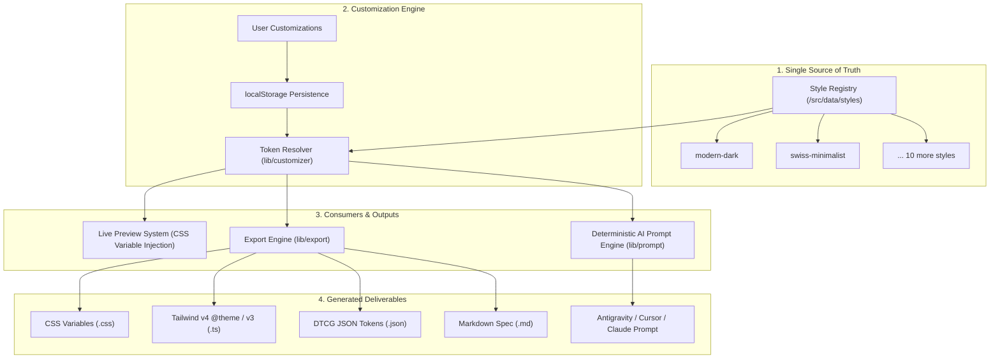

# StyPro — Technical Architecture & Engineering Guide

## System Architecture

StyPro is built as a zero-cloud-dependency, client-side design discovery and design-system generation platform. It bridges the gap between visual inspiration and production-ready code.



---

## Core Engineering Principles

### 1. Zero Backend & Zero External API Overhead
StyPro requires no external databases, no paid LLM API keys, and no server state.
- **Customization State:** Managed using local React state and persisted to browser `localStorage`.
- **Prompt Generation:** Built deterministically via rule-based schema compilation.
- **File Downloads:** Generated on the fly via standard browser `Blob` and `URL.createObjectURL` APIs.

### 2. Single-Source-of-Truth Design Token Pipeline
Every visual element in StyPro derives from a single `DesignStyle` definition:
1. `src/types/style.ts` defines the canonical schema.
2. `src/data/styles/` instantiates all 12 styles.
3. `src/lib/style-utils.ts` transforms tokens into scoped CSS variables injected on the preview root container.
4. `src/lib/export/normalize-tokens.ts` flattens the token tree into canonical leaves (`NormalizedTokenLeaf[]`) for validation and multi-format serialization.

### 3. Non-Destructive Customizer Resolution
User overrides (`CustomizationOverrides`) are stored as clean diffs rather than full style clones:
- Category resets allow reverting only colors, typography, or geometry without losing other edits.
- Deep diff inspectors highlight exact deviations from the canonical style baseline.

---

## Directory Organization

```text
StyPro/
├── src/
│   ├── app/                      # Next.js App Router routes
│   │   ├── layout.tsx            # Global root layout & font provider
│   │   ├── page.tsx              # Landing homepage with interactive showcase
│   │   ├── explore/              # Style Discovery catalogue with search & filters
│   │   ├── styles/[slug]/        # Detailed style deep dive & token inspectors
│   │   ├── customize/[slug]/     # 3-pane interactive visual customizer
│   │   └── export/[slug]/        # Multi-format export workspace & code preview
│   ├── components/               # Modular UI components
│   │   ├── customizer/           # Customizer workspace, control panels, prompt modal
│   │   ├── explore/              # Explorer search bar, category pills, style cards
│   │   ├── export/               # Export workspace, code viewers, format tabs
│   │   ├── home/                 # Hero, features, how-it-works, benefits
│   │   ├── layout/               # Global Navbar, Footer, PageContainer
│   │   ├── preview/              # Realistic component preview specimens
│   │   └── styles/               # Style headers, palettes, typography ladders
│   ├── data/styles/              # All 12 curated design style definitions
│   ├── lib/
│   │   ├── customizer/           # Overrides persistence, resolver, diff engine
│   │   ├── export/               # Token normalization, validators, serializers
│   │   ├── prompt/               # 14-section AI prompt generators (Cursor/Claude/Antigravity)
│   │   └── style-utils.ts        # CSS variable injection helper
│   ├── tests/                    # Native TypeScript unit test suites
│   └── types/                    # TypeScript data contracts & schemas
├── docs/                         # Architecture, schemas, style specs, execution logs
└── public/                       # Static public assets
```

---

## Performance & Accessibility

1. **Sub-second Prerendering:** Next.js static prerendering compiles all 44 routes into static HTML/JSON during build time.
2. **Zero Layout Shift (CLS = 0):** All container aspect ratios, font swap metrics (`next/font`), and preview frames use fixed geometry or CSS containment.
3. **Contrast Compliance (WCAG 2.1 AA):** All 12 styles maintain compliant foreground/background contrast ratios for primary body text and buttons.
4. **Reduced Motion Support:** All animations adhere to `prefers-reduced-motion` media queries and customizer speed settings.
