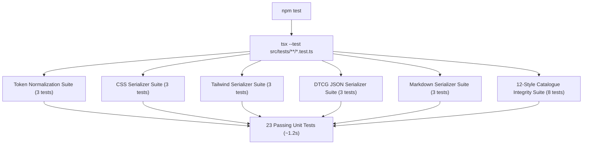

# StyPro — Testing Strategy & Verification Guide

## Testing Architecture

StyPro uses Node.js 24's native test runner (`node:test` + `node:assert/strict`) executed via `tsx` for TypeScript execution. This setup yields sub-second test runs without the overhead of Jest or Vitest.



---

## Test Suites Breakdown

### 1. Style Catalogue Integrity (`src/tests/styles/style-catalogue.test.ts`)
- **Coverage:** Verifies all 12 styles in `src/data/styles/`.
- **Assertions:**
  - Exactly 12 styles are registered in `allStyles`.
  - All style IDs and slugs are unique.
  - Categories belong to the allowed `StyleCategory` taxonomy.
  - Every style resolves accurately via `getStyleBySlug()`.
  - Category filters and featured styles query helpers function properly.
  - Normalization and validation run on all 12 styles with zero errors.
  - Cross-format export serialization (CSS, Tailwind v4, Tailwind v3, DTCG JSON, Markdown) runs without throwing on all 12 styles.

### 2. Token Normalization & Validation (`src/tests/export/normalize-tokens.test.ts`)
- **Coverage:** `normalizeDesignTokens()` and `validateNormalizedTokens()`.
- **Assertions:**
  - Normalizes canonical styles into structured token leaves.
  - Correctly tags leaves with CSS variable names and categories.
  - Applies user overrides non-destructively.
  - Flags invalid hex colors and malformed token values.

### 3. CSS Variable Serializer (`src/tests/export/css-serializer.test.ts`)
- **Coverage:** `serializeToCss()`.
- **Assertions:**
  - Generates standard `:root` wrapper.
  - Includes `--sty-*` namespaced variables.
  - Handles light-mode and dark-mode color distributions.
  - Reflects user overrides accurately.

### 4. Tailwind Theme Serializer (`src/tests/export/tailwind-serializer.test.ts`)
- **Coverage:** `serializeToTailwind()`.
- **Assertions:**
  - Generates modern Tailwind v4 `@theme` block.
  - Generates classic Tailwind v3 `tailwind.config.ts` TypeScript file.
  - Maps colors, fonts, and border radii cleanly into Tailwind namespace.

### 5. DTCG JSON Serializer (`src/tests/export/dtcg-serializer.test.ts`)
- **Coverage:** `serializeToDtcg()`.
- **Assertions:**
  - Outputs valid, parseable JSON.
  - Includes required `$value` and `$type` attributes.
  - Verifies token grouping under `color`, `dimension`, and `fontFamily`.

### 6. Markdown Serializer (`src/tests/export/markdown-serializer.test.ts`)
- **Coverage:** `serializeToMarkdown()`.
- **Assertions:**
  - Emits complete Markdown document with title, philosophy, and component rules.
  - Produces formatted Markdown tables for semantic color tokens.

---

## Verification Commands

### 1. Run Unit Tests
```bash
npm test
```
*Expected: 23 tests passing across 6 suites in ~1.2s.*

### 2. Run TypeScript Type Check
```bash
npx tsc --noEmit
```
*Expected: Exits with code 0 and zero errors.*

### 3. Run ESLint Linting
```bash
npm run lint
```
*Expected: 0 errors, 0 warnings.*

### 4. Run Production Build & Prerender Validation
```bash
npm run build
```
*Expected: Next.js Turbopack compiles successfully and prerenders all 44 static routes.*
